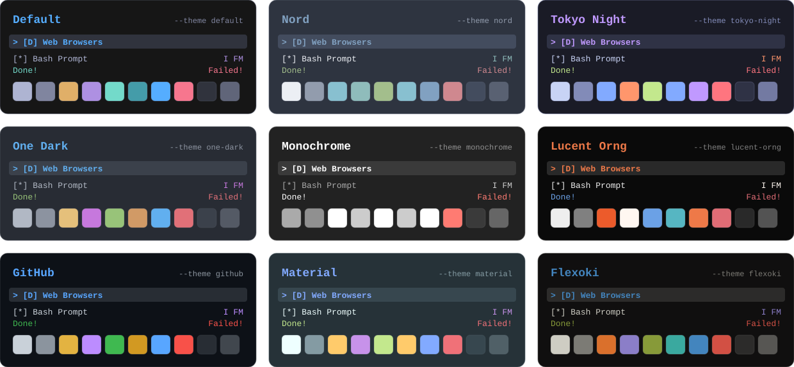

<a id="readme-top"></a>

<div align="center">

<picture>
  <source media="(prefers-color-scheme: dark)" srcset="assets/banner-dark.svg">
  <source media="(prefers-color-scheme: light)" srcset="assets/banner-light.svg">
  
</picture>

</div>

<br>

<p align="center">
  
</p>
<p align="center"><sub><i>The above preview was generated with the help of <a href="https://github.com/charmbracelet/vhs">vhs</a>, give them a ⭐</i></sub></p>

---

<div align="center">

<a href="https://github.com/ChrisTitusTech/linutil/releases/latest"></a>

<a href="https://crates.io/crates/linutil_tui"></a>
<a href="https://discord.gg/RUbZUZyByQ"></a>

<br>

<a href="#quick-start">Quick start</a> &nbsp; / &nbsp;
<a href="#explore">Explore the toolbox</a> &nbsp; / &nbsp;
<a href="#-themes">Themes</a> &nbsp; / &nbsp;
<a href="#installation">Install</a> &nbsp; / &nbsp;
<a href="#reference">Reference</a> &nbsp; / &nbsp;
<a href="#contributing">Contribute</a>

## Set up your apps. Get game-ready. Make Linux yours.
</div>
<br>
<a id="quick-start"></a>

## Get straight to it

<sub>01 / QUICK START</sub>

Open a terminal, run the stable launcher, and pick your next task.

```bash
curl -fsSL https://christitus.com/linux | sh
```

<details>
  <summary><b>Want to try the development branch?</b></summary>

Use the dev launcher to try the latest work:

```bash
curl -fsSL https://christitus.com/linuxdev | sh
```

</details>

> [!NOTE]
> Linutil is actively developed. Found an issue? [Tell us about it](https://github.com/ChrisTitusTech/linutil/issues).

<br>

<a id="explore"></a>

## A place for every task

<sub>02 / EXPLORE THE TOOLBOX</sub>

From a fresh install to a daily tune-up, start with one of five categories.

### Category descriptions

<table>
  <tr>
    <th align="center">Category</th>
    <th align="center">What you’ll find</th>
  </tr>
  <tr>
    <td width="25%" align="center" valign="middle"><b>📦 Applications Setup</b></td>
    <td align="left" valign="top">Build your everyday toolkit: browsers, communication, design, developer and office tools, terminals, shells, prompts and containers.</td>
  </tr>
  <tr>
    <td width="25%" align="center" valign="middle"><b>🎮 Gaming</b></td>
    <td align="left" valign="top">Get ready to play with emulators, launchers, gaming tools and setups, plus game-specific mods and fixes.</td>
  </tr>
  <tr>
    <td width="25%" align="center" valign="middle"><b>🛡️ Security</b></td>
    <td align="left" valign="top">Set a firewall baseline with FirewallD or UFW. Run a Lynis security audit or an rkhunter rootkit scan.</td>
  </tr>
  <tr>
    <td width="25%" align="center" valign="middle"><b>⚙️ System Setup</b></td>
    <td align="left" valign="top">Shape your system with distro-specific setup, desktop environments, updates, cleanup, audio, swap and themes.</td>
  </tr>
  <tr>
    <td width="25%" align="center" valign="middle"><b>🔧 Utilities</b></td>
    <td align="left" valign="top">Take care of the details: monitors, printers, user accounts, Bluetooth, bootable USBs, services, SSH and local AI tools.</td>
  </tr>
</table>

Search across categories with <kbd>/</kbd>, read the exact script with <kbd>p</kbd>, then press <kbd>Enter</kbd> to run it. A confirmation prompt appears by default.

<table>
  <tr>
    <td width="50%" valign="top">
      <b>See the impact</b><br>
      Command flags show what a task touches: packages, files, services and more.
    </td>
    <td width="50%" valign="top">
      <b>Keep it relevant</b><br>
      Distro-aware filtering shows the commands that apply to your distribution.
    </td>
  </tr>
  <tr>
    <td width="50%" valign="top">
      <b>Build a queue</b><br>
      Use multi-select to queue several commands and run them in one go.
    </td>
    <td width="50%" valign="top">
      <b>Keep the output</b><br>
      Press <kbd>l</kbd> after a command finishes to save its output to a log file.
    </td>
  </tr>
</table>

<br>

## 🎨 Themes

Cycle through the themes with <kbd>t</kbd>, or start with one using `--theme <name>`.

<p align="center">
  
</p>

A `compatible` theme is also available for terminals without truecolor support.

<br>

<a id="installation"></a>

## Pick your install

<sub>03 / PACKAGES &amp; REPOSITORIES</sub>

Prefer a package? Choose your route below, or browse availability across distributions.

[](https://repology.org/project/linutil/versions)

<details>
  <summary><b>Arch Linux</b></summary>

Linutil can be installed on [Arch Linux](https://archlinux.org) with three different [AUR](https://aur.archlinux.org) packages:

- `linutil` - Stable release compiled from source
- `linutil-bin` - Stable release pre-compiled
- `linutil-git` - Compiled from the last commit (not recommended)

by running:

```bash
git clone https://aur.archlinux.org/<package>.git
cd <package>
makepkg -si
```

Replace `<package>` with your preferred package.

If you use [yay](https://github.com/Jguer/yay), [paru](https://github.com/Morganamilo/paru) or any other [AUR Helper](https://wiki.archlinux.org/title/AUR_helpers), it's even simpler:

```bash
paru -S linutil
```

Replace `paru` with your preferred helper and `linutil` with your preferred package.

</details>
<details>
  <summary><b>openSUSE</b></summary>

Linutil can be installed on openSUSE with:

```bash
sudo zypper install linutil
```

</details>
<details>
  <summary><b>Cargo</b></summary>

Linutil can be installed via [Cargo](https://doc.rust-lang.org/cargo) with:

```bash
cargo install linutil_tui
```

Note that crates installed using `cargo install` require manual updating with `cargo install --force` (update functionality is [included in Linutil](https://linutil.christitus.com/userguide/updates/))

</details>

<br>

<a id="reference"></a>

## Make it work your way

<sub>04 / CONFIGURATION &amp; CONTROLS</sub>

Start with your preferred settings, or keep the keyboard guide close by.

### Configuration

Use a TOML file with `linutil --config /path/to/config.toml` (or `-c`).

<details>
  <summary><b>Config options and example</b></summary>

Available options:
- `auto_execute` - A list of commands to execute automatically (can be combined with `--skip-confirmation`)
- `skip_confirmation` - Boolean (equal to `--skip-confirmation`)
- `size_bypass` - Boolean (equal to `--size-bypass`)

Example config:

```toml
# example_config.toml

auto_execute = [
    "Fastfetch",
    "Alacritty",
    "Kitty"
]

skip_confirmation = true
size_bypass = true
```

```bash
linutil --config /path/to/example_config.toml
```

</details>

<details>
  <summary><b>CLI arguments</b></summary>

| Option | Description |
| --- | --- |
| `-c`, `--config <CONFIG>` | Path to the configuration file |
| `-t`, `--theme <THEME>` | Theme to start with: `default`, `compatible`, `nord`, `tokyo-night`, `one-dark`, `monochrome`, `lucent-orng`, `github`, `material` or `flexoki` |
| `-y`, `--skip-confirmation` | Skip the confirmation prompt before running commands |
| `-u`, `--override-validation` | Show all options, disregarding compatibility checks (unsafe) |
| `-s`, `--size-bypass` | Bypass the terminal size limit |
| `-m`, `--mouse` | Enable mouse interaction |
| `-r`, `--bypass-root` | Bypass the root user check |
| `-h`, `--help` | Print help |

For installer options:

```bash
curl -fsSL https://christitus.com/linux | sh -s -- --help
```

</details>

### Keyboard guide

| Keys | Action |
| --- | --- |
| <kbd>↑</kbd> <kbd>↓</kbd> / <kbd>k</kbd> <kbd>j</kbd> | Move selection |
| <kbd>Enter</kbd> / <kbd>→</kbd> | Open a folder or run a command |
| <kbd>Esc</kbd> / <kbd>←</kbd> / <kbd>h</kbd> | Go back to the parent folder |
| <kbd>Tab</kbd> / <kbd>Shift</kbd>+<kbd>Tab</kbd> | Switch category |
| <kbd>1</kbd> - <kbd>5</kbd> | Jump to a category |
| <kbd>/</kbd> | Search |
| <kbd>p</kbd> | Script preview |
| <kbd>d</kbd> | Command description |
| <kbd>v</kbd> | Multi-selection mode (<kbd>Space</kbd> to select) |
| <kbd>t</kbd> | Cycle theme |
| <kbd>s</kbd> | Toggle stars |
| <kbd>?</kbd> | Help |
| <kbd>q</kbd> / <kbd>Ctrl</kbd>+<kbd>C</kbd> | Quit |

<br>

<a id="documentation"></a>
<a id="contributing"></a>

## Keep exploring. Get involved.

<sub>05 / DOCS &amp; COMMUNITY</sub>

<table>
  <tr>
    <td width="50%" valign="top">
      <h3>📖 Go deeper</h3>
      <p>Find walkthroughs and more ways to use Linutil in the official documentation.</p>
      <a href="https://linutil.christitus.com/"><b>Read the docs →</b></a>
    </td>
    <td width="50%" valign="top">
      <h3>🛠 Build with us</h3>
      <p>Bring a fix, a new tool or a better explanation. Start with the contributing guidelines.</p>
      <a href=".github/CONTRIBUTING.md"><b>Start contributing →</b></a>
    </td>
  </tr>
</table>

<p align="center">
  Enjoying Linutil? <a href="https://github.com/ChrisTitusTech/linutil"><b>Give it a star ⭐</b></a> or <a href="https://discord.gg/RUbZUZyByQ"><b>join the conversation on Discord ↗</b></a>.
</p>

<br>

---

## 🏅 Thanks to All Contributors

Thank you to everyone who has contributed to the development of Linutil. Your efforts are greatly appreciated, and you're helping make this tool better for everyone!

[](https://github.com/ChrisTitusTech/linutil/graphs/contributors)

## 📜 Contributor Milestones

- 2024/07 - Original Linutil Rust TUI was developed by [@JustLinuxUser](https://github.com/JustLinuxUser).
- 2024/09 - TabList (Left Column) and various Rust Core/TUI Improvements developed by [@lj3954](https://github.com/lj3954)
- 2024/09 - Cargo Publish, AUR, Rust, and Bash additions done by [@koibtw](https://github.com/koibtw)
- 2024/09 - Rust TUI Min/Max, MultiSelection, and Bash additions done by [@jeevithakannan2](https://github.com/jeevithakannan2)
- 2024/09 - Various bash updates and standardization done by [@nnyyxxxx](https://github.com/nnyyxxxx)
- 2024/09 - Multiple bash script additions done by [@guruswarupa](https://github.com/guruswarupa)
- 2026/01 - TUI Refresh with Logo by [@Abs313a](https://github.com/Abs313a)
- 2026/03 - Linutil docs website creation by [@seanh1995](https://github.com/seanh1995)

<div align="center">

<br>

<a href="#readme-top">↑ Back to top</a> &nbsp; · &nbsp; <a href="https://linutil.christitus.com/">Documentation</a> &nbsp; · &nbsp; <a href="https://github.com/ChrisTitusTech/linutil/issues">Report an issue</a>

</div>
